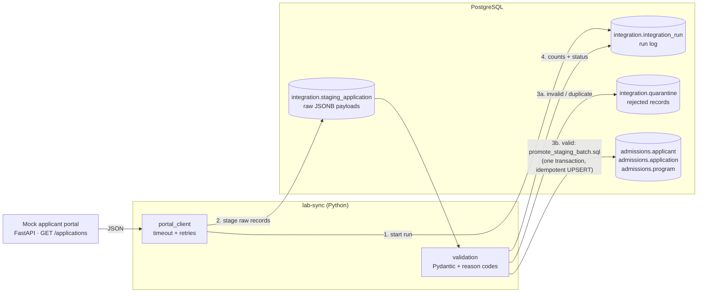
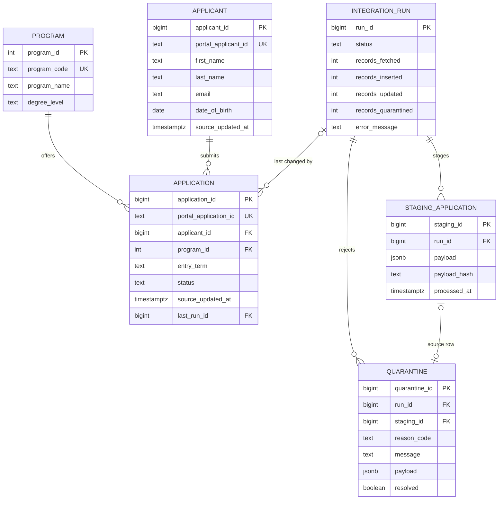

# University Application Integration Lab

[](https://github.com/minimascientific/university-integration-lab/actions/workflows/ci.yml)

A small, end-to-end data integration pipeline for university admissions data, built with
Python, PostgreSQL and a REST API. A mock applicant portal serves application records. A sync
job fetches them, lands the raw records in a staging table, validates them, and promotes the
valid ones into clean tables with idempotent UPSERTs. Bad records go to a quarantine table
instead of being lost. Every run is logged, and a set of troubleshooting queries and a
runbook cover the common failure cases.

> **Fictional data.** "Summit Ridge University", its applicant portal and every record in this
> repository are fictional and generated with Faker. This project is not affiliated with,
> endorsed by, or modelled on any real institution, and it contains no real personal data.

**Stack:** Python 3.12 · PostgreSQL 16 · FastAPI · httpx · Pydantic · psycopg 3 · pytest ·
Docker Compose · GitHub Actions · uv

📊 **[Slide overview (PDF, 10 slides)](docs/admissions-pipeline-overview.pdf)**: the
architecture, the safeguards (retries, quarantine, idempotent UPSERTs, run logging) and the
data model, explained visually.

## Architecture



## Data model



The full schema, with a written decision for each design question, is in
[`db/ddl/001_schema.sql`](db/ddl/001_schema.sql).

## Quickstart (macOS)

Requires a Docker runtime ([Colima](https://github.com/abiosoft/colima) or Docker Desktop),
[uv](https://docs.astral.sh/uv/), and `psql` (`brew install libpq`).

```bash
colima start                         # start the Docker runtime
cp .env.example .env                 # then set a local password in both places
docker compose up -d                 # PostgreSQL 16; schema is applied on first start
uv sync                              # Python 3.12 + dependencies

set -a; source .env; set +a
psql "$DATABASE_URL" -f db/seed/001_programs.sql

# terminal 1: the mock portal
uv run uvicorn integration_lab.mock_portal:app --port 8001

# terminal 2: run syncs
uv run lab-sync                         # normal batch
uv run lab-sync --scenario duplicates   # repeats + a newer revision in one batch
uv run lab-sync --scenario invalid      # bad email, missing name, unknown program, ...
uv run lab-sync --scenario error        # portal returns HTTP 500
```

Reset the database (re-applies the schema): `docker compose down -v && docker compose up -d`

## How a sync run works

1. **Start a run.** Insert an `integration_run` row with status `running`. It is committed
   immediately, so even a crash leaves a trace.
2. **Fetch.** `GET /applications` with a 5 s timeout. Connection errors and 5xx responses are
   retried 3 times with exponential backoff (0.5 s, 1 s, 2 s). If the portal stays down, the run
   is marked `failed` with the error message and nothing else is written.
3. **Stage.** Every record is stored exactly as received (JSONB plus a SHA-256 hash) in
   `staging_application`, and committed.
4. **Validate.** Pydantic checks each record and gives each rejected one a reason code:
   `missing_required_field`, `invalid_format`, `unknown_program`, `invalid_status`, or
   `duplicate_in_batch` (older copies of a record that appears twice in the batch).
5. **Promote, in one transaction.** Quarantine the rejects, then run
   [`promote_staging_batch.sql`](db/queries/promote_staging_batch.sql). It is a single
   statement of chained data-modifying CTEs that upserts applicants and applications, marks
   staging rows processed, and records the counts. If the database rejects the batch (for
   example a constraint violation), everything rolls back and the job retries **row by row**,
   one `SAVEPOINT` per record using [`upsert_applicant.sql`](db/queries/upsert_applicant.sql)
   and [`upsert_application.sql`](db/queries/upsert_application.sql). Only the offending
   record is quarantined (`constraint_violation`).
6. **Finish.** Set counts, `finished_at`, and status: `succeeded`, `partial` (some records
   quarantined) or `failed`. Every log line is tagged `[run N]`.

## Design decisions

| Decision | Why |
|---|---|
| **Staging before the real tables** | Keeps the raw evidence, lets bad records be quarantined instead of lost, and makes any run replayable. |
| **Idempotent UPSERTs** (`INSERT ... ON CONFLICT DO UPDATE`) on the portal's IDs | Re-running a sync, or receiving the same record twice, never creates duplicates. |
| **Newer wins** (`source_updated_at`) | Records can arrive out of order. An older version never overwrites a newer one. |
| **Skip no-op updates** (`IS DISTINCT FROM`) | `updated_at` reflects real data changes, not every time the job ran. |
| **Quarantine, not reject** | One bad record doesn't fail the batch; the payload and reason are kept for triage and replay. |
| **Run log** (`integration_run`) | Every run records what it fetched, inserted, updated, skipped and rejected, and why it failed. |
| **Retries with backoff, only for transient errors** | 5xx and connection errors are retried; 4xx means our request is wrong, so it fails fast. |
| **Surrogate keys + unique natural keys** | Internal IDs stay stable if a source code changes; the UNIQUE natural key enforces identity. |
| **Email not unique** | Shared family emails are legitimate. Possible duplicate people are found with a report instead of being blocked. |
| **Validation in Python and in the database** | Pydantic gives readable errors; constraints are the final guard. |

## Troubleshooting

[`docs/runbook.md`](docs/runbook.md) covers four scenarios: portal down, records quarantined,
suspected duplicate applicants, and rows stuck in staging. Each has the symptom, the query to
run from [`db/queries/`](db/queries/), and the fix. Every query file is commented line by line.

## Tests

```bash
uv run pytest -v
```

The suite (19 tests) runs against a separate `integration_lab_test` database that it creates on
the same server, so development data is untouched. The portal is replaced by
`httpx.MockTransport`, so no server needs to be running. It covers:

- **Duplicate records:** in-batch duplicates quarantined, the newest version wins, reruns are
  idempotent, newer records update, stale records are ignored.
- **Invalid data:** each reason code lands in quarantine, and valid rows in the same batch
  still load.
- **API failure:** HTTP 500 retried then the run is marked `failed` with no partial data;
  connection refused; 4xx not retried.
- **Database rejection:** a record that passes validation but violates a constraint triggers
  the row-by-row `SAVEPOINT` fallback.

CI ([`.github/workflows/ci.yml`](.github/workflows/ci.yml)) runs ruff and pytest against a
PostgreSQL 16 service container on every push.

## Project layout

```
db/ddl/        schema (applied automatically on first `docker compose up`)
db/seed/       synthetic programs
db/queries/    UPSERTs, the promote transaction, report and troubleshooting queries
docs/          runbook and slide overview (PDF)
src/integration_lab/
  mock_portal.py    mock REST API (FastAPI + Faker, deterministic)
  portal_client.py  HTTP client with timeout and retries
  validation.py     Pydantic models and quarantine reason codes
  db.py             connection and SQL-file loader
  sync.py           the lab-sync job
tests/         pytest suite
```

## Possible extensions

Course enrollment for admitted applicants, incremental fetches (`?updated_since=`),
pagination, and a replay command for resolved quarantine records.
